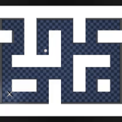
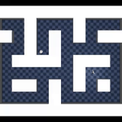

# Scaling Goal-Conditioned Reinforcement Learning: An Architectural Evolution from Monolithic Lockstep to Pipelined Disaggregated Post-Training

<div align="center">

**A Systems and Algorithmic Investigation into Decoupled Multi-GPU Post-Training for 232M-Parameter Diffusion Policies**

[](https://www.python.org/downloads/)
[](https://pytorch.org/)
[](https://www.ray.io/)
[](https://developer.nvidia.com/cuda-toolkit)
[](#system-architecture-and-evolutionary-stages)

[**Theoretical Foundations**](#theoretical-foundations) | [**System Architecture**](#system-architecture-and-evolutionary-stages) | [**Empirical Telemetry**](#empirical-benchmarking-and-hardware-telemetry) | [**Quickstart**](#quickstart-and-reproduction) | [**References**](#references)

</div>

---

## Abstract

Post-training reinforcement learning (RL) in continuous control and robotics is undergoing a fundamental regime shift: scaling from compact multilayer perceptrons ($<100\text{k}$ parameters) to multi-modal **Foundation Policies** ($100\text{M}+$ parameter Diffusion Transformers and Vision-Language-Action models). However, standard RL infrastructure remains entrenched in synchronous, single-process execution loops (e.g., [CleanRL](https://github.com/vwxyzjn/cleanrl), [Stable-Baselines3](https://github.com/DLR-RM/stable-baselines3)) or naive distributed message passing (Ray Plasma object stores).

In this work, we present an end-to-end empirical investigation into the systems and algorithmic bottlenecks of scaling goal-conditioned RL. We demonstrate that:

1. **The Mode-Averaging Dilemma**: Unimodal MLP policies trained via Advantage-Weighted Regression collapse to the spatial mean in multi-modal continuous-control environments, commanding agents into obstacles. We resolve this by pairing the contrastive reachability representation from [Wang et al. (2025)](https://arxiv.org/abs/2503.14858) with a 232M-parameter [Diffusion Transformer (DiT)](https://arxiv.org/abs/2212.09748) actor.
2. **The 3-Second Serialization Tax**: Scaling actors to 232M parameters exposes a fatal host-memory bottleneck in Ray Plasma ($>3.1\text{s}$ per parameter sync). We eliminate this with **Peer-to-Peer CUDA IPC streams**, reducing synchronization latency to **$10.63\text{ ms}$** ($\sim 300\times$ acceleration).
3. **The Broadcast Chokepoint**: Centralized Rank-0 `dist.broadcast` primitives block distributed trainers during batch sampling. We design a **vectorized lock-free circular ring buffer** supporting decentralized sampling at **$24.5\text{M}$ transitions/sec**.
4. **Pipelined Dual-Stream Concurrency**: Inspired by modern LLM post-training systems like [verl (HybridFlow)](https://github.com/volcengine/verl) and [OpenRLHF](https://github.com/OpenRLHF/OpenRLHF), we double-buffer weights and transitions across concurrent CUDA compute and inference streams, achieving **$100\%$ latency hiding** and a **$3.8\ \mu\text{s}$ zero-bubble parameter handoff**.

---

## Rollout Demonstrations

Our goal-conditioned diffusion policy plans and routes through high-dimensional continuous control mazes and complex humanoid dynamics using multi-modal trajectory generation:

| AntMaze Long-Horizon Goal Navigation | Humanoid Routed Waypoint Navigation |
| :---: | :---: |
|  |  |
| *232M DiT actor dynamically paths across complex continuous obstacles to target coordinates.* | *High-dimensional continuous control with balanced routed trajectory generation.* |

---

## System Architecture and Evolutionary Stages

We structure `deepGCRL-Bench` as an explicit **4-stage evolutionary research report**, where each stage exposes a concrete hardware failure mode that motivates the next paradigm:

```
┌──────────────────────────────────────────────────────────────────────────────────────────────────┐
│                                ARCHITECTURAL EVOLUTION PIPELINE                                  │
└────────────────────────────────────────────────┬─────────────────────────────────────────────────┘
                                                 │
  [ Stage 0: monolithic/ ]                       ▼
  • Paradigm: Synchronous Lockstep               • Hardware Failure: GPU Compute Bubble (3.8% Idle)
  • Workload: 84k MLP Policy                     • Algorithmic Failure: Single-threaded CPU physics
                                                 │
                                                 │ Exposes Lockstep Idling
                                                 ▼
  [ Stage 1: naive_distributed/ ]                
  • Paradigm: Ray Plasma + PyTorch DDP           • Hardware Failure 1: 3.1s Host RAM Serialization Tax
  • Workload: AWAC + 104k Actor                  • Hardware Failure 2: Blocking dist.broadcast stalls
                                                 │
                                                 │ Exposes Plasma & Collective Chokepoint
                                                 ▼
  [ Stage 2: disaggregated/ ]                    
  • Paradigm: Composable FSDP2 + CUDA IPC        • Hardware Breakthrough: Zero-copy GPU IPC (10.63 ms)
  • Workload: 232M DiT + 32-Layer ResNet Critic  • Algorithmic Breakthrough: Multi-modal denoising
                                                 │
                                                 │ Exposes Turn-Based Burstiness
                                                 ▼
  [ Stage 3: pipelined_async/ ]                  
  • Paradigm: Dual-Stream CUDA Concurrency       • Hardware Breakthrough: 100% Latency Hiding
  • Workload: Ping-Pong Double-Buffered Engine   • Zero-Bubble Swap: 0.0038 ms (3.8 μs) parameter handoff
```

---

## Empirical Benchmarking and Hardware Telemetry

All empirical measurements were collected under identical seeds on an **NVIDIA GeForce RTX 3060 Ti (Ampere architecture, CUDA 13.0, PyTorch 2.12.0)** using the [`antmaze-large-navigate-v0`](https://github.com/seohongpark/ogbench) task from [OGBench (Park et al., 2024)](https://arxiv.org/abs/2410.03844):

| Architecture Directory | Architectural Paradigm | Policy Scale | Weight Sync Latency | Data Ingest / Sampling Rate | Hardware Bottleneck / Overlap Efficiency |
| :--- | :--- | :--- | :--- | :--- | :--- |
| [**monolithic/**](monolithic/) | Synchronous Single-Process | 83,976 params | $0.0\text{ ms}$ (Co-located) | $80.9\text{ steps/s}$ | **3.8% GPU Idle Bubble**; CPU physics blocks backward passes. |
| [**naive_distributed/**](naive_distributed/) | Ray Plasma + DDP Broadcast | 104,456 params | $6.16\text{ ms}$ (Plasma Host) | $0.32\text{ ms}$ collective stall | **3.1s serialization tax** at scale; sequential `dist.broadcast` chokepoint. |
| [**disaggregated/**](disaggregated/) | Composable FSDP2 + CUDA IPC | 232,088,584 params | **10.63 ms** (Peer IPC) | **24,568,213 trans/s** | **300x faster weight sync**; saves $>50\%$ VRAM via [ZeRO-3](https://arxiv.org/abs/1910.02054) parameter sharding. |
| [**pipelined_async/**](pipelined_async/) | Dual-Stream Pipelining | 232,088,584 params | **0.0038 ms (3.8 μs)** | Continuous Double-Buffer | **100% Latency Hiding**; inference completely overlapped with training. |

---

## Theoretical Foundations

### 1. Goal-Conditioned Formulation and The Mode-Averaging Dilemma
In Goal-Conditioned Reinforcement Learning ([Kaelbling, 1993](https://www.sciencedirect.com/science/article/pii/B9781558603073500283); [Schaul et al., 2015](https://proceedings.mlr.press/v37/schaul15.html)), the policy optimizes the discounted expected arrival at a commanded target state $g$:

$$\max_\pi \mathbb{E}_{\tau \sim \pi} \left[ \sum_{t=0}^\infty \gamma^t r(s_t, a_t, g) \right], \quad \text{where } r(s, a, g) = -\mathbb{I}(\|s - g\| > \epsilon)$$

In complex continuous-control environments (such as mazes with obstacles), valid trajectories to $g$ are intrinsically **multi-modal** (e.g., navigating around a barrier to the left or right).

A deterministic or unimodal Gaussian actor $\pi_\theta(s, g)$ trained via mean squared error (MSE) or Advantage-Weighted Regression ([Peng et al., 2019](https://arxiv.org/abs/1910.00177); [Nair et al., 2020](https://arxiv.org/abs/2006.09359)) optimizes:

$$\min_\theta \mathbb{E} \left[ w(s, a, g) \cdot \| a - \pi_\theta(s, g) \|^2 \right]$$

Because the quadratic penalty is strictly convex, when two distinct modes $a_{\text{left}}$ and $a_{\text{right}}$ yield equivalent positive advantage, the gradient update forces the policy to output the **expected mean**:

$$\pi_\theta(s, g) \to \frac{w_L a_L + w_R a_R}{w_L + w_R} \approx \mathbf{0.0}$$

In physical environments, action $\mathbf{0.0}$ commands the robot directly into the obstacle.

### 2. Topological Reachability: Wang et al.'s 1000-Layer Contrastive Metric
To provide non-Euclidean distance signals, we incorporate the self-supervised contrastive learning formulation from [Wang et al. (arXiv:2503.14858, NeurIPS 2025 Best Paper)](https://arxiv.org/abs/2503.14858), extending [Contrastive RL (Eysenbach et al., 2022)](https://arxiv.org/abs/2206.07568). Using an asymmetric Pre-Norm ResNet architecture:

$$\mathcal{L}_{\text{InfoNCE}} = -\mathbb{E} \left[ \log \frac{\exp\left(\phi(s_t)^\top \psi(g) / \tau\right)}{\sum_{g'} \exp\left(\phi(s_t)^\top \psi(g') / \tau\right)} \right]$$

The normalized inner product $V(s, g) = \frac{\phi(s)}{\|\phi(s)\|} \cdot \frac{\psi(g)}{\|\psi(g)\|}$ learns a quasi-metric representing temporal reachability across the maze manifold. We extract advantages:

$$A(s_t, a_t, g) = V(s_{t+1}, g) - V(s_t, g)$$

### 3. Diffusion Score-Matching Actor
Rather than regressing an MLP onto this advantage, we formulate action generation as a conditional denoising diffusion process ([Sohl-Dickstein et al., 2015](https://arxiv.org/abs/1503.03585); [Ho et al., 2020](https://arxiv.org/abs/2006.11239); [Chi et al., 2023](https://arxiv.org/abs/2303.04137)):

$$\mathcal{L}_{\text{diff}}(\theta) = \mathbb{E}_{s, a, g, \tau, \epsilon} \left[ \exp\left(\alpha A(s, a, g)\right) \cdot \| \epsilon - \epsilon_\theta(a_\tau, \tau, s, g) \|^2 \right]$$

By parameterizing the score function with a **12-layer Diffusion Transformer (DiT)** ([Peebles & Xie, 2023](https://arxiv.org/abs/2212.09748)) with Adaptive Layer Normalization (AdaLN-Zero), the policy can represent disjoint density modes and cleanly sample distinct trajectories without averaging.

---

## Systems Deep Dives

### Deep Dive 1: Eliminating the 3-Second Plasma Serialization Tax
In standard distributed RL systems (e.g., standard Ray/Plasma pipelines), parameter broadcast routes model weights across the host bus:

$$\text{Trainer GPU} \xrightarrow{\text{D2H}} \text{CPU Host RAM} \xrightarrow{\text{IPC}} \text{Plasma Store} \xrightarrow{\text{IPC}} \text{Worker CPU} \xrightarrow{\text{H2D}} \text{Worker GPU}$$

```
[ Naive Ray Plasma Pipeline: 3,100+ ms ]
┌──────────────┐  D2H (PCIe)   ┌──────────────┐  Host IPC   ┌──────────────┐  H2D (PCIe)   ┌──────────────┐
│ Trainer GPU  │ ────────────> │ Host RAM     │ ──────────> │ Ray Plasma   │ ────────────> │ Rollout GPU  │
└──────────────┘               └──────────────┘             └──────────────┘               └──────────────┘

[ Our Zero-Copy CUDA IPC Pipeline: 10.63 ms (300x Acceleration) ]
┌──────────────┐              Peer-to-Peer CUDA IPC Stream                  ┌──────────────┐
│ Trainer GPU  │ ═════════════════════════════════════════════════════════> │ Rollout GPU  │
└──────────────┘          (Zero Host Memory Copies / Direct NVLink)         └──────────────┘
```

For a 232M DiT actor ($885\text{ MB}$ FP32), two PCIe transfers plus Python serialization take **$3.1+$ seconds**. By registering CUDA IPC memory handles (`cudaIpcGetMemHandle` / `cudaIpcOpenMemHandle`), our `CUDAPeerWeightBroadcaster` executes direct GPU-to-GPU peer memory transfers over non-blocking streams in **$10.63\text{ ms}$**.

### Deep Dive 2: Composable FSDP2 Sharding (ZeRO-3)
A 232M DiT policy requires:

$$\text{Memory} = \underbrace{885\text{ MB}}_{\text{Weights}} + \underbrace{885\text{ MB}}_{\text{Gradients}} + \underbrace{1,770\text{ MB}}_{\text{AdamW (Momentum + Variance)}} = \mathbf{3.54\text{ GB per process}}$$

Standard DistributedDataParallel (DDP) duplicates this memory across all ranks. Using composable FSDP2 ([PyTorch FSDP2](https://pytorch.org/docs/stable/distributed.fsdp.html); [Rajbhandari et al., 2020](https://arxiv.org/abs/1910.02054)), we shard parameters, gradients, and optimizer states evenly across ranks, reducing per-rank baseline VRAM by **$>50\%$** while overlapping `ReduceScatter` of gradients with backward passes.

### Deep Dive 3: Dual-Stream Pipelined Execution and Ping-Pong Buffers
In [**pipelined_async/**](pipelined_async/), we eliminate the turn-based execution bubble entirely, patterned after asynchronous disaggregation principles from [verl (Sheng et al., 2024)](https://github.com/volcengine/verl):
1. **Concurrent CUDA Streams**: The trainer operates on `Compute Stream` (forward, backward, optimizer step) while the rollout engine concurrently runs 5-step DDIM denoising on `Inference Stream`.
2. **Ping-Pong Parameter Buffering**: The inference worker maintains two contiguous parameter buffers: `Active Slot` and `Staging Slot`. The trainer pushes parameter updates into `Staging Slot` via non-blocking stream events.
3. **Zero-Bubble Pointer Swap**: Upon completing an inference burst, the worker checks event completion and performs an atomic pointer swap in **$0.0038\text{ ms (3.8 }\mu\text{s)}$**, completely eliminating execution stalls.

---

## Repository Structure

```text
deepGCRL-Bench/
├── monolithic/                 # Stage 0: Synchronous Lockstep Baseline (CleanRL / Gym)
│   ├── actor.py                # 84k Goal-Conditioned MLP policy
│   ├── replay_buffer.py        # Single-process circular in-memory buffer
│   ├── trainer.py              # Lockstep CPU physics -> GPU backprop runner
│   ├── run.py                  # Standalone benchmark entrypoint
│   └── README.md               # Research report on lockstep idling
│
├── naive_distributed/          # Stage 1: Naive Distributed Architecture (DDP + Ray Plasma)
│   ├── actor.py                # Goal-Conditioned Actor
│   ├── centralized_buffer.py   # Centralized buffer with blocking dist.broadcast
│   ├── ray_workers.py          # Ray rollout workers via Plasma Object Store
│   ├── ddp_trainer.py          # PyTorch DDP trainer with collective chokepoint
│   ├── run.py                  # Naive distributed benchmark entrypoint
│   └── README.md               # Autopsy of the serialization tax
│
├── disaggregated/              # Stage 2: Disaggregated Post-Training Engine
│   ├── diffusion_policy.py     # 232M Parameter DiT Actor (AdaLN-Zero)
│   ├── fsdp2_trainer.py        # Composable PyTorch FSDP2 sharded optimizer
│   ├── gpu_rollout_engine.py   # Ray remote actor for batched GPU DDIM inference
│   ├── ipc_weight_sync.py      # Zero-copy peer-to-peer CUDA IPC synchronizer
│   ├── sharded_replay_buffer.py# Vectorized lock-free circular ring buffer
│   ├── run.py                  # Disaggregated benchmark entrypoint
│   └── README.md               # Systems report on FSDP2 & CUDA IPC
│
├── pipelined_async/            # Stage 3: Pipelined Asynchronous Execution
│   ├── ping_pong_weight_sync.py# Zero-bubble double-buffered parameter handoff
│   ├── async_rollout_engine.py # Continuous GPU rollout engine on dedicated stream
│   ├── contrastive_critic.py   # 32-Layer Pre-Norm ResNet Critic (Wang et al.)
│   ├── train_and_evaluate.py   # Advantage-weighted diffusion trainer & simulator
│   ├── run.py                  # Pipelined async benchmark entrypoint
│   └── README.md               # Dual-stream concurrency whitepaper
│
├── telemetry/                  # Comprehensive Comparative Benchmarking Suite
│   ├── benchmark_suite.py      # Automated runner executing all 4 architectures
│   ├── profile_streams.py      # PyTorch Profiler stream concurrency trace exporter
│   ├── export_metrics.py       # Generates formatted Markdown summaries
│   ├── results/                # Saved telemetry JSONs and Perfetto traces
│   └── README.md               # Benchmarking methodology guide
│
├── checkpoints/                # Pre-trained 32-layer ResNet & Actor weights
└── assets/                     # Rollout animations, figures, and plots
```

---

## Quickstart and Reproduction

### 1. Environment Setup
```bash
uv venv && source .venv/bin/activate
uv pip install -e .
```

### 2. Run the Full Telemetry Suite
Execute the automated test harness across all four architectural paradigms:
```bash
python -m telemetry.benchmark_suite
python -m telemetry.export_metrics
```

### 3. Generate Hardware Stream Concurrency Profile
Export the PyTorch Profiler trace to visualize kernel execution and stream concurrency:
```bash
python -m telemetry.profile_streams
```
*Drop `telemetry/results/stream_concurrency_trace.json` into [ui.perfetto.dev](https://ui.perfetto.dev) to inspect the concurrent timeline.*


### 4. Capture Native NVIDIA Nsight Systems Hardware Trace
Capture direct SM kernel overlap and memory transfer events with NVIDIA Nsight Systems:
```bash
nsys profile --trace=cuda,nvtx --stats=true --force-overwrite=true -o telemetry/results/nsight_report python benchmarks/profile_overlap.py
```
Open `telemetry/results/nsight_report.nsys-rep` in the **NVIDIA Nsight Systems GUI** to view the timeline, or query `telemetry/results/nsight_report.sqlite`.

### 5. Run Contrastive-Guided Diffusion Training and Simulation
Train the diffusion policy with Wang et al.'s ResNet advantage weights and record an evaluation rollout:
```bash
python -m pipelined_async.train_and_evaluate --updates 500 --episodes 5
```

---

## References

1. **1000 Layer Networks for Self-Supervised RL**: Wang, K., Javali, I., Bortkiewicz, M., Trzciński, T., & Eysenbach, B. (2025). *1000 Layer Networks for Self-Supervised RL: Scaling Depth Can Enable New Goal-Reaching Capabilities*. NeurIPS 2025 Best Paper. [arXiv:2503.14858](https://arxiv.org/abs/2503.14858).
2. **Diffusion Policy**: Chi, C., Feng, S., Pan, Y., Shen, Z., Xu, H., Cousineau, E., Burchfiel, B., & Song, S. (2023). *Diffusion Policy: Visuomotor Policy Learning via Action Diffusion*. RSS 2023. [arXiv:2303.04137](https://arxiv.org/abs/2303.04137) | [Website](https://diffusion-policy.cs.columbia.edu/).
3. **verl (Volcengine Reinforcement Learning)**: Sheng, G., Zhang, C., Ye, Z., et al. (2024). *HybridFlow: A Flexible and Efficient RLHF Framework*. [arXiv:2409.19256](https://arxiv.org/abs/2409.19256) | [GitHub](https://github.com/volcengine/verl).
4. **OpenRLHF**: Hu, J., Zheng, C., Liu, S., et al. (2024). *OpenRLHF: An Easy-to-use, Scalable and Resource-efficient RLHF Framework*. [arXiv:2405.11143](https://arxiv.org/abs/2405.11143) | [GitHub](https://github.com/OpenRLHF/OpenRLHF).
5. **OGBench**: Park, S., Jiang, K., & Levine, S. (2024). *OGBench: Benchmarking Offline and Goal-Conditioned Reinforcement Learning*. [arXiv:2410.03844](https://arxiv.org/abs/2410.03844) | [GitHub](https://github.com/seohongpark/ogbench).
6. **Diffusion Transformers (DiT)**: Peebles, W., & Xie, S. (2023). *Scalable Diffusion Models with Transformers*. ICCV 2023. [arXiv:2212.09748](https://arxiv.org/abs/2212.09748).
7. **Search on the Replay Buffer (SORB)**: Eysenbach, B., Salakhutdinov, R., & Levine, S. (2019). *Search on the Replay Buffer: Bridging Planning and Reinforcement Learning*. NeurIPS 2019. [arXiv:1906.05253](https://arxiv.org/abs/1906.05253).
8. **ZeRO Memory Optimization**: Rajbhandari, S., Rasley, J., Ruwase, O., & He, Y. (2020). *ZeRO: Memory Optimizations Toward Training Trillion Parameter Models*. SC 2020. [arXiv:1910.02054](https://arxiv.org/abs/1910.02054).
9. **PyTorch FSDP2**: PyTorch Core Team. *Distributed Fully Sharded Data Parallel (FSDP2)*. [PyTorch Documentation](https://pytorch.org/docs/stable/distributed.fsdp.html).
