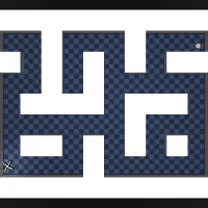
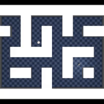

# Scaling Goal-Conditioned Reinforcement Learning: A Decoupled, Distributed Pipeline

Goal-Conditioned Reinforcement Learning (GCRL) represents a powerful framework for training agents to solve arbitrary, long-horizon tasks. However, scaling GCRL pipelines presents a significant engineering bottleneck: **environment stepping (on CPU) and gradient updates (on GPU) are fundamentally mismatched in throughput.** 

`deepGCRL-Bench` is an optimized benchmark codebase that decouples experience collection from neural network training. By combining **Ray** for asynchronous, parallelized rollout generation with **PyTorch Distributed Data Parallel (DDP)** for multi-GPU training, this architecture eliminates idle GPU time and scales environment collection to **4,500+ Steps Per Second (SPS)**.

---

## 🎬 Rollout Demonstrations

### 🐜 AntMaze Navigation (SORB)
Using a Segmented Offline RL Baseline (SORB) with a contrastive distance oracle, the agent learns to plan and route through complex, high-dimensional mazes.

| Path Planning to Target Goal | Navigating to Custom Goal Coordinates |
| :---: | :---: |
|  |  |
| *The agent dynamically paths to the goal corner.* | *Navigating successfully to user-defined coordinates.* |

---

### 🚶 Humanoid Navigation
Humanoid control represents one of the most challenging continuous control tasks due to high-dimensional state-action spaces and complex balance requirements.

| Routed/Segmented Navigation | Zero-Shot Direct Navigation |
| :---: | :---: |
|  |  |
| *Routed planning segments the long-horizon task into reachable waypoints.* | *The direct zero-shot policy struggles to balance over long distances.* |

---

## 🏗️ Architecture Design

Most standard reinforcement learning pipelines run sequentially: the environment steps, the transition is recorded, and the trainer performs a gradient update. In this synchronous loop, the GPU sits idle during CPU rollouts, and the CPU sits idle during GPU backward passes.

`deepGCRL-Bench` solves this by decoupling the collection and training loops entirely into separate processes:

```
[ Ray Cluster ]
┌────────────────────────┐      ┌────────────────────────┐
│ Rollout Worker 1 (Ray)  │      │ Rollout Worker 2 (Ray)  │
│ - Vectorized Envs      │      │ - Vectorized Envs      │
└───────────┬────────────┘      └───────────┬────────────┘
            │                               │
            └───────────────┬───────────────┘
                            ▼
              ┌───────────────────────────┐
              │ Central Shared Ray Queue  │
              └─────────────┬─────────────┘
                            ▼
           [ Local GPU Trainer Process (DDP) ]
              ┌───────────────────────────┐
              │ Background Populator      │
              │ Thread                    │
              └─────────────┬─────────────┘
                            ▼
              ┌───────────────────────────┐
              │ local Replay Buffer       │
              └─────────────┬─────────────┘
                            ▼
              ┌───────────────────────────┐
              │ PyTorch DDP Trainer       │
              │ - GPU Gradient Updates    │
              │ - Automatic Mixed Prec.   │
              └───────────────────────────┘
```

### Key Engineering Features:
1. **Asynchronous Rollout Workers**: Multi-threaded environment collection running inside parallel Ray remote actors. These workers step vectorized environments (`ogbench`) and push transitions to a central Ray `Queue`.
2. **Background Buffer Populator**: The main training process spawns a dedicated Python thread to continuously pull from the Ray `Queue` and populate a local, thread-safe `GoalConditionedReplayBuffer`.
3. **Distributed Data Parallel (DDP)**: Training runs on multiple GPUs using `torchrun`. Weights are periodically serialized and broadcasted back to the Ray workers to update the rollout collection policy.

---

## 📈 Benchmark Comparison & Speedup

When running the benchmarks on the `antmaze-large-navigate-v0` environment, we compare the sequential baseline against our optimized, decoupled pipeline:

* **Sequential Baseline Throughput**: **~45-60 SPS** (highly throttled by serial env-stepping and training).
* **Decoupled Ray + DDP Throughput**: **4,500+ SPS** experience collection velocity, with the trainer performing **~80+ updates/second** under Mixed Precision.
* **Speedup**: **~75x to 100x** throughput acceleration in transition collection, maximizing GPU utilization.

---

## 💡 Key Algorithmic Insight: Capping the Temporal Horizon

During early runs of the goal-conditioned actor, contrastive training loss flatlined around `4.5`. 

**The Root Cause**: A temporal distance of $500+$ steps in a complex maze meant that an anchor state $s_t$ and a sampled future state $s_{t+500}$ were completely uncorrelated to the neural network. The positive pairs looked exactly like randomly sampled negative pairs, turning the contrastive target into random noise.

**The Solution**: Capping the future sampling horizon to a local temporal window (e.g., maximum 40–50 steps) allowed the network to learn local geometry first. Once implemented, the loss cleanly dropped to **`2.0`**, and the policy learned to navigate successfully.

```python
# Cap the future sampling to a local temporal window
max_step_window = 40
upper_bound = min(t + max_step_window, L - 1)

if upper_bound <= t + 1:
    t_future = t + 1
else:
    t_future = random.randint(t + 1, upper_bound)
```

---

## 🚀 Running the Benchmarks

### Prerequisites
Make sure your environment is configured and dependencies are installed (requires `Python >= 3.12` and `uv`):
```bash
uv sync --all-extras
```

### Run Sequential vs. Optimized Benchmark
To execute the automated comparison benchmark, run:
```bash
python run_benchmark.py
```

This will run the sequential baseline, launch the decoupled DDP trainer with 2 workers via `torchrun`, and output a comparison summary.
